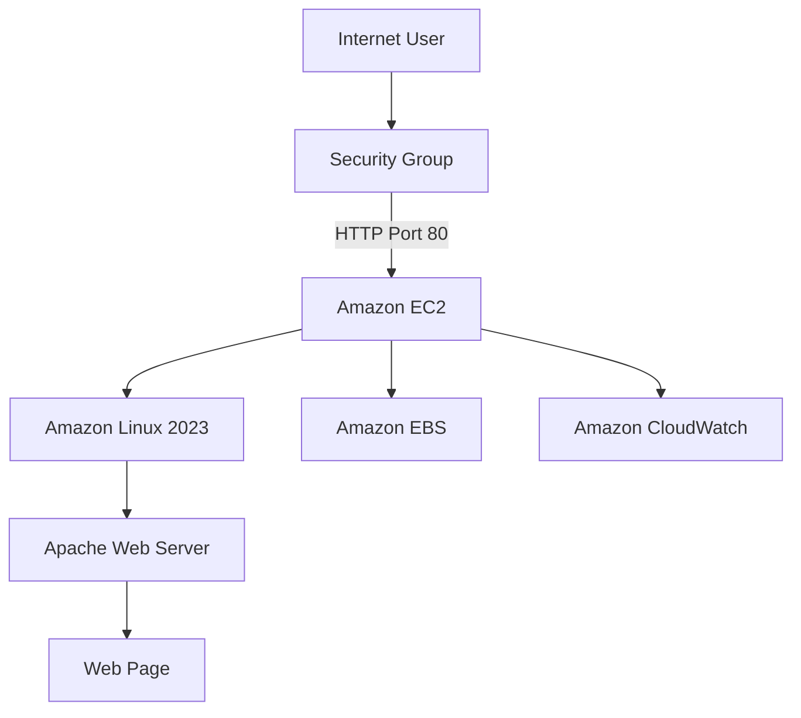

# AWS Lab 3: Introduction to Amazon EC2

## Project Overview

This project demonstrates how to launch, configure, manage, monitor, and resize an Amazon EC2 instance using the AWS Management Console.

The lab focuses on deploying a simple web server on Amazon Linux 2023 and managing its security, availability, and computing resources.

## Objectives

- Launch an EC2 instance with termination protection.
- Configure and monitor EC2 instance health.
- Configure Security Groups to allow HTTP traffic.
- Deploy an Apache web server using User Data.
- Resize an EC2 instance from `t2.micro` to `t2.small`.
- Increase EBS storage from 8 GiB to 10 GiB.
- Explore EC2 Service Quotas.
- Test stop protection.

## AWS Services Used

| Service | Purpose |
|---|---|
| Amazon EC2 | Virtual server hosting |
| Amazon VPC | Network environment |
| Security Groups | Inbound traffic control |
| Amazon EBS | Persistent storage |
| Amazon CloudWatch | Instance monitoring |
| AWS Service Quotas | Resource limits |

## Architecture



## Implementation Steps

### 1. Launch EC2 Instance

- Created an EC2 instance named `Web Server`.
- Selected Amazon Linux 2023 AMI.
- Selected `t2.micro` instance type.
- Configured the `vockey` key pair.
- Selected Lab VPC and PublicSubnet1.
- Created a Security Group named `Web Server security group`.
- Enabled Termination Protection.

### 2. Configure User Data

Used the following Bash script to automatically install and configure Apache:

```bash
#!/bin/bash
dnf install -y httpd
systemctl enable httpd
systemctl start httpd
echo '<html><h1>Hello From Your Web Server!</h1></html>' > /var/www/html/index.html
```

### 3. Monitor EC2 Instance

- Verified EC2 status checks.
- Checked System Reachability and Instance Reachability.
- Explored CloudWatch monitoring metrics.
- Reviewed system logs.
- Captured an instance screenshot.

### 4. Configure Security Group

Initially, HTTP access was blocked because there were no inbound rules.

Added the following rule:

| Type | Protocol | Port | Source |
|---|---|---|---|
| HTTP | TCP | 80 | 0.0.0.0/0 |

Successfully accessed the web server through its Public IPv4 address.

### 5. Resize EC2 Instance

Changed the instance configuration:

| Resource | Before | After |
|---|---|---|
| Instance Type | t2.micro | t2.small |
| EBS Volume | 8 GiB | 10 GiB |

Enabled Stop Protection after resizing.

### 6. Explore EC2 Service Quotas

Explored Amazon EC2 service quotas and examined the limits for running On-Demand instances.

### 7. Test Stop Protection

- Attempted to stop the protected instance.
- Verified that AWS prevented the stop operation.
- Disabled Stop Protection.
- Successfully stopped the instance.

## Lab Screenshots

Screenshots demonstrating the implementation and final results are available in the `screenshots/` directory.

## Results

Successfully completed the EC2 lab and achieved the following:

- Deployed an Apache web server on Amazon EC2.
- Configured HTTP access through Security Groups.
- Verified successful web server access.
- Monitored EC2 health and performance.
- Resized compute and storage resources.
- Tested termination and stop protection.

## What I Learned

- Understanding Amazon EC2 instance lifecycle.
- Deploying applications using EC2 User Data.
- Managing network access using Security Groups.
- Monitoring instances using CloudWatch.
- Resizing EC2 instances and EBS volumes.
- Applying protection mechanisms to prevent accidental operations.
- Understanding AWS Service Quotas.

## Conclusion

This hands-on lab provided practical experience in managing Amazon EC2 instances, configuring network security, deploying a web server, and scaling cloud resources.

**Status: Successfully Completed**


## Lab Screenshots

### 1. Monitor EC2 Instance


### 2. Web Server Output


### 3. Lab Architecture


### 4. Lab Results

